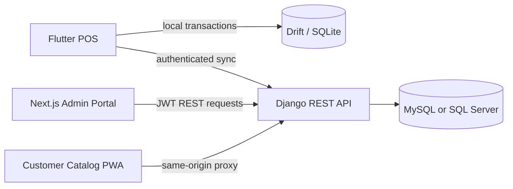

# XantaraPOS

XantaraPOS is an offline-first point-of-sale system for retail and food service.
The system combines a Flutter register application, a Next.js administration
portal, a Django REST API, and a customer-facing catalog PWA.

This repository contains the canonical Flutter POS client. The other services
are maintained as sibling repositories in the local development workspace.

## System Architecture



### Applications

| Application | Local directory | Responsibility | Default URL |
| --- | --- | --- | --- |
| Flutter POS | `Xantara-POS` | Register, checkout, offline storage, hardware, staff authorization, and sync | Platform dependent |
| Admin portal | `xantara-web-frontend` | Inventory, sales, customers, suppliers, branches, staff, reports, and settings | `http://127.0.0.1:3000` |
| REST API | `xantara-web-backend` | Authentication, central business data, inventory projection, reporting, and sync | `http://127.0.0.1:8000` |
| Customer PWA | `xantara-customer-pwa` | Public branch catalog and printable branch QR codes | `http://127.0.0.1:3001` |

Expected local workspace:

```text
C:\Dev\
|-- Xantara-POS\
|-- xantara-web-frontend\
|-- xantara-web-backend\
`-- xantara-customer-pwa\
```

## Flutter Repository Layout

```text
Xantara-POS/
|-- assets/                  Brand images and application assets
|-- docs/                    Architecture, compliance, deployment, and handoff notes
|-- lib/
|   |-- core/                Auth, compliance, hardware, networking, payments, routing, sync
|   |-- features/            POS, checkout, orders, inventory, analytics, settings, and displays
|   |-- local/               Drift schema, DAOs, local models, seeds, and repositories
|   |-- shared/              Reusable providers, services, and widgets
|   |-- app.dart             Material application and router binding
|   `-- main.dart            Database, window, and provider initialization
|-- test/                    Unit, repository, integration, and widget tests
|-- android/ ios/ macos/     Mobile and macOS platform projects
|-- linux/ windows/ web/     Desktop and web platform projects
`-- pubspec.yaml             Flutter dependencies and asset configuration
```

Flutter development and production builds start from the repository root and
`lib/main.dart`.

## Core Flutter Design

- **State management:** Riverpod with explicit providers.
- **Navigation:** GoRouter with authenticated admin and cashier routes.
- **Local persistence:** Drift over SQLite, including web worker and WASM support.
- **Offline operation:** Local repositories persist sales and durable sync work.
- **POS modes:** Food-service and grocery/retail register experiences.
- **Customer display:** A secondary desktop window driven by shared POS state.
- **Hardware:** Receipt printing and extensible POS hardware job processing.
- **Compliance:** BIR invoice, audit trail, and reporting foundations.
- **Cloud synchronization:** Durable outbound synchronization is implemented;
  complete server-to-register pull synchronization remains an evolving area.

See [docs/OFFLINE_ARCHITECTURE.md](docs/OFFLINE_ARCHITECTURE.md),
[docs/INVENTORY_SYNC_API.md](docs/INVENTORY_SYNC_API.md), and
[docs/BIR_COMPLIANCE_BASELINE.md](docs/BIR_COMPLIANCE_BASELINE.md) for the
detailed contracts.

## Prerequisites

- Flutter stable with Dart `>=3.3.0 <4.0.0`
- Node.js suitable for Next.js 16
- Python 3.13 and the backend packages in `requirements.txt`
- MySQL for the normal local/production-style backend, or SQLite for an isolated demo
- A supported browser for the web clients

On Windows, Visual Studio Desktop development with C++ is also required for the
Flutter Windows build.

## Quick Start

Start the backend first, then the web applications. The Flutter POS can run
independently against its local database, but cloud features require the API.

### 1. Start the Django API

```powershell
cd C:\Dev\xantara-web-backend
py -m venv .venv
.\.venv\Scripts\Activate.ps1
pip install -r requirements.txt
```

Choose one database configuration and use it consistently for `migrate`,
`seed_data`, `check`, and `runserver`.

For an isolated SQLite demo:

```powershell
python manage.py migrate --settings=config.settings.sqlite_local
python manage.py seed_data --settings=config.settings.sqlite_local
python manage.py runserver 127.0.0.1:8000 --settings=config.settings.sqlite_local
```

For MySQL local development, copy `.env.example` to `.env`, configure the
database values, create the database, and run:

```powershell
python manage.py migrate --settings=config.settings.local
python manage.py seed_data --settings=config.settings.local
python manage.py runserver 127.0.0.1:8000 --settings=config.settings.local
```

The seed command prints local demonstration credentials. Seeded credentials are
for development only and must never be used in production.

> Important: `config.settings.local` and `config.settings.sqlite_local` target
> different databases. Running migrations with one and the server with the other
> produces missing-table errors even when Django reports migrations as applied.

### 2. Start the administration portal

```powershell
cd C:\Dev\xantara-web-frontend
npm ci
$env:NEXT_PUBLIC_API_URL="http://127.0.0.1:8000"
npm run dev -- --hostname 127.0.0.1 --port 3000
```

Open `http://127.0.0.1:3000`.

`NEXT_PUBLIC_API_URL` is embedded into the browser bundle. Set it before running
the development server or production build. Production normally uses the
same-origin `/api/` reverse proxy and does not need a localhost fallback.

### 3. Start the customer catalog PWA

```powershell
cd C:\Dev\xantara-customer-pwa
Copy-Item .env.example .env.local
npm ci
npm run dev -- --hostname 127.0.0.1 --port 3001
```

Open `http://127.0.0.1:3001/b/MAIN`, replacing `MAIN` with an active inventory
branch code. The printable QR page is `/qr/MAIN`.

### 4. Run the Flutter POS

```powershell
cd C:\Dev\Xantara-POS
flutter pub get
flutter run -d windows
```

Other useful targets:

```powershell
flutter run -d chrome
flutter run -d android
```

After changing Drift schemas or generated models, regenerate sources:

```powershell
dart run build_runner build --delete-conflicting-outputs
```

## Validation

Run these checks before publishing changes.

### Flutter POS

```powershell
flutter analyze --no-fatal-infos
flutter test
```

### Django API

Use the same settings module used by the running server:

```powershell
python manage.py check --settings=config.settings.sqlite_local
python manage.py test --settings=config.settings.sqlite_local
```

### Admin portal

```powershell
npm run lint
npm run build
```

### Customer PWA

```powershell
npm run lint
npm run build
```

## Data and Sync Boundaries

- The Flutter register owns its local offline database and must remain usable
  during network loss.
- The Django API is the central authority for web administration and cloud data.
- Register uploads use authenticated, idempotent sync events.
- Inventory-affecting server events are projected atomically.
- The admin portal writes directly to the authenticated REST API.
- The customer PWA reads only the public branch catalog projection and does not
  expose internal stock or product-management fields.

Do not bypass repository or service boundaries with direct database access from
the frontend applications.

## Production Notes

- Use `config.settings.production` with MySQL or SQL Server.
- Store secrets in deployment environment variables, never in Git.
- Serve the admin portal and API behind HTTPS and a same-origin reverse proxy.
- Set exact `ALLOWED_HOSTS`, `CORS_ALLOWED_ORIGINS`, and
  `CSRF_TRUSTED_ORIGINS` values.
- Back up the database before migrations and deploy application releases
  atomically with a tested rollback path.
- Customer QR codes must use the deployed HTTPS customer-app origin.

Deployment details are maintained in
[docs/HOSTINGER_DEMO_DEPLOYMENT.md](docs/HOSTINGER_DEMO_DEPLOYMENT.md).

## Contributing

1. Keep changes scoped to the owning repository and layer.
2. Preserve offline behavior when changing checkout, inventory, or sync logic.
3. Add focused tests for business rules and cross-service contracts.
4. Do not commit local databases, build output, logs, credentials, or generated
   scratch files.
5. Update the relevant architecture document when a public contract changes.

## Repository Status Notes

- `lib/` is the canonical Flutter application.
- `build/`, `.dart_tool/`, `.tools/`, `output/`, and `tmp/` are generated or
  local-only directories and are excluded from version control.
- Generated platform registrant files should change only when plugin
  dependencies change.
